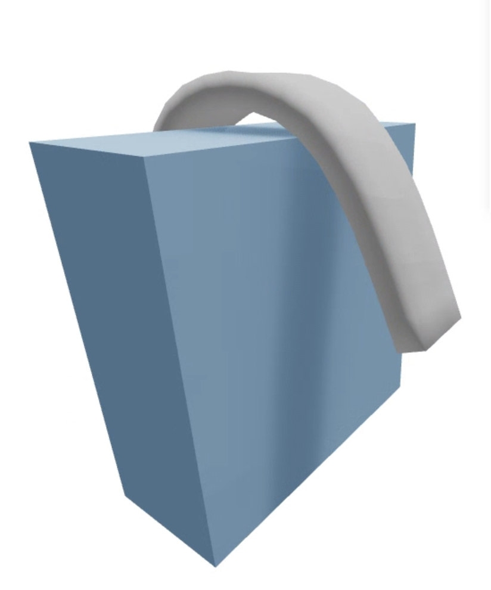
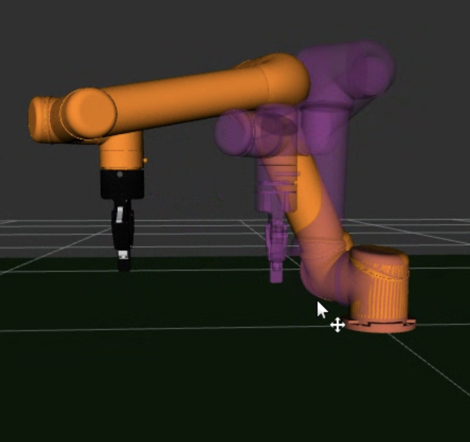
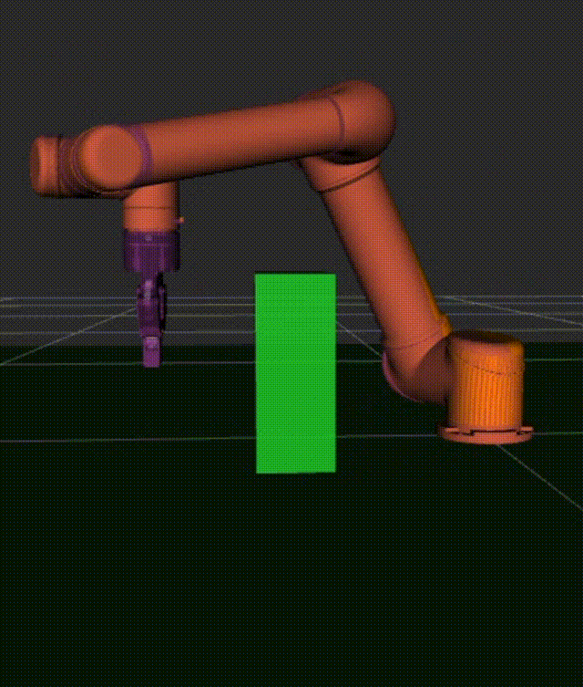
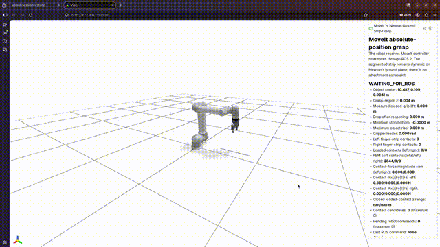
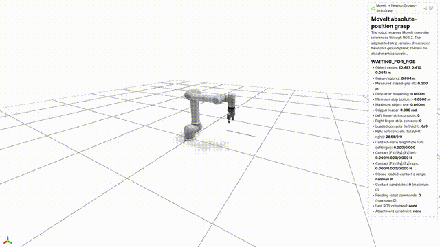
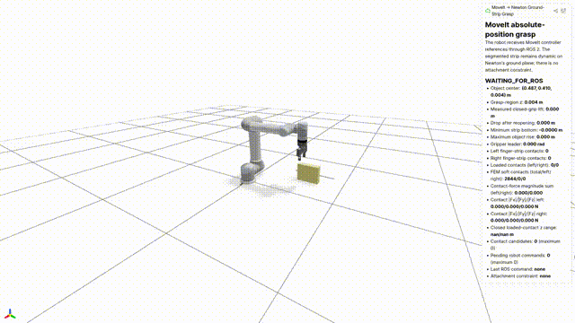

# Rigid-obstacle milestone: Steps A/B and controlled Step C attempts

Steps A and B validate the obstacle physics, planning controls,
planning-scene cleanup, and Newton endpoint integration.  The latest Step C
attempt restores the verified four-stage safe pre-grasp route.  C0 stops at
its incomplete Cartesian-path guard, before any arm command or grasp; no
complete grasp around an obstacle is claimed.

The single source of truth is
[`config/obstacles.yaml`](../../../config/obstacles.yaml).  Obstacles remain
disabled by default, so the existing grasp scene is unchanged unless a test
explicitly enables them.

## Step A0 — rigid-sphere smoke test

The retained A0 test drops a rigid sphere onto the configured static box.  On
home ARM64 CPU, commit `a6d2af3fa97bfbc2955e97427e6371132ddd2df0` passed:

- maximum penetration: `0.0 m`
- settled and finite: `true`
- real-time factor: `0.686`

Result: [`step_a0_sphere_cpu_arm64.json`](results/step_a0_sphere_cpu_arm64.json)

## Step A1 — FEM-strip contact test

A0 cannot validate VBD soft contact.  A1 therefore drops the FEM strip
(`252` particles, `600` tetrahedra) onto the same box using full-surface
rigid-soft contact.  Its contact law comes from `model.soft_contact_ke`,
`model.soft_contact_kd`, and `model.soft_contact_mu`; the box's rigid-body
`ke/kd` values do not substitute for them.

The run stopped automatically after the one-second center-height range fell
below the settling threshold:

- soft-contact candidates observed: `220`
- maximum particle penetration: `0.000213 m` (`0.213 mm`, below `1 mm`)
- settling time / wall time: `8.717 / 49.681 s`
- finite and settled: `true`

Result: [`step_a1_fem_strip_cpu_arm64.json`](results/step_a1_fem_strip_cpu_arm64.json)

Newton viewer: FEM strip settled on the rigid box after free-fall (max penetration 0.21 mm).

## Step B — MoveIt positive and negative controls

All Step B cases used one unchanged MoveIt bringup and target `x=0.20 m`.
Commit `9695193eb107b31ebaff6d795a16b879071af87e` produced:

| Case | Maximum tool height | Minimum robot-to-box distance | Outcome |
|---|---:|---:|---|
| Box disabled | `0.308737 m` | `-0.060328 m` | route succeeds but intersects the hypothetical box |
| Box enabled, OMPL | `0.401116 m` | `0.003664 m` | route changes and remains clear |
| Box enabled, explicit safe route | `0.451119 m` | `0.012481 m` | all spatial stages reach 100% |
| Tall wall enabled | n/a | n/a | planning fails as required |

This is the required causal control: the target is identical, while the
enabled scene produces a higher route and positive clearance.

A second negative control replaced the box with a wall from `z=0` to `2 m`
and `4 m` across Y.  The requested pose is separated by a barrier taller than
the reachable safe-transit height, and planning failed.  The test rejects any
run that prints `PLAN_ONLY_SUCCEEDED` for this wall.

Finally, after enabled and tall-wall runs, a default disabled run sent a
`CollisionObject::REMOVE` for `grasp_route_box`.  The planning-scene query
reported `confirmed_absent=true`; this prevents an object from persisting in
`move_group` across node runs.

- machine-readable result:
  [`step_b_20261014_021854.result.json`](results/step_b_20261014_021854.result.json)
- complete log:
  [`step_b_20261014_021854.log`](results/step_b_20261014_021854.log)

RViz: box disabled — route passes through the box location (apex 0.309 m, min distance −6.0 cm).

RViz: box enabled — route detours around the box (min distance +0.28 cm).

### Evidence provenance

All paths below are repository-relative.  The commit is the exact source
recorded by the test, not the later documentation commit.

| Evidence | Status | Tested commit | Repository-relative path |
|---|---|---|---|
| Step A0 sphere | accepted | `a6d2af3fa97bfbc2955e97427e6371132ddd2df0` | `docs/experiments/rigid-obstacles/results/step_a0_sphere_cpu_arm64.json` |
| Step A1 FEM strip | accepted | `a6d2af3fa97bfbc2955e97427e6371132ddd2df0` | `docs/experiments/rigid-obstacles/results/step_a1_fem_strip_cpu_arm64.json` |
| Step B controls, run `20261014_021854` | accepted | `9695193eb107b31ebaff6d795a16b879071af87e` | `docs/experiments/rigid-obstacles/results/step_b_20261014_021854.result.json` and `.log` |

The following runs remain in the repository as diagnostic history and must
not be used as acceptance evidence:

| Run | Status | Reason | Retained evidence |
|---|---|---|---|
| `20261014_021734` | superseded / incomplete | The enabled same-target OMPL route was absent, so route metrics and causal comparison were incomplete. | `docs/experiments/rigid-obstacles/results/step_b_20261014_021734.superseded.log` and `.result.json` |
| `20261014_022739` | superseded / incomplete | The run stopped after adding the floor and produced no result JSON. | `docs/experiments/rigid-obstacles/results/step_b_20261014_022739.superseded.log` |

## Newton endpoint integration before Step C

When `enabled=false`, `build_scene()` receives no obstacle, adds no shape, and
the endpoint reports:

- `obstacles_enabled=false`
- `obstacle_shapes=0`
- `maximum_robot_obstacle_contacts=0`
- `object_obstacle_max_penetration_m=0.0`

When enabled, the endpoint reads the same config, creates one static box with
rigid and particle collision enabled, and deliberately adds no robot-obstacle
filter.  The smoke run reports `obstacle_shapes=1`,
`maximum_robot_obstacle_contacts=0`, and
`object_obstacle_max_penetration_m=0.012690`.

That last value is diagnostic rather than a pass claim: the Step B route box
overlaps part of the strip's initial ground pose.  The new metric exposes this
condition before Step C instead of silently hiding it.

- enabled: [`JSON`](results/newton_endpoint_obstacles_enabled_cpu_arm64.json),
  [`log`](results/newton_endpoint_obstacles_enabled_cpu_arm64.log)
- disabled: [`JSON`](results/newton_endpoint_obstacles_disabled_cpu_arm64.json),
  [`log`](results/newton_endpoint_obstacles_disabled_cpu_arm64.log)

## Configuration and CI guards

- `pick_at_position.cpp` has no numeric obstacle fallbacks.  All obstacle
  parameters must be supplied by the launch/config path.
- CI rejects every configured box dimension below `0.01 m`, reducing the risk
  of one-step tunneling.
- `candidate_contact_grasp_pass` now also requires
  `maximum_robot_obstacle_contacts == 0`.  A dependency-free unit check covers
  zero, one, and multiple obstacle contacts.
- The earlier provenance guard in commit `8342375` remains unchanged.

## Step C attempt — cable moved behind a wall

Commit `caa568994c0250c86c1dab3cb0d91fc5b603b0a5` keeps the verified FEM
cable, grasp settings, Jazzy start joints, and Newton `BASE_ARM` unchanged.
The shared profile moves the cable center to `(0.487, -0.180, 0.004) m`.
The approved wall is centered at `(0.487, -0.035, 0.10) m` with size
`(0.20, 0.05, 0.20) m`.  Both Newton and MoveIt read the same profile.

### Geometry preflight

The first `0.30 m` wall was too close to `upper_arm_link` along X.  Shortening
it to `0.20 m` changed the limiting geometry instead of merely moving the
wall in Y:

| Measurement | Result |
|---|---:|
| Closest start-pose link | `ur/robotiq_85_right_finger_link` |
| Closest-shape separation direction | `y` |
| Robot-to-wall distance | `0.049792 m` |
| Clearance after `0.020 m` padding | `0.029792 m` |
| Cable surface-to-wall-face gap | `0.117000 m` |
| Open-finger-to-wall clearance | `0.043792 m` |
| Newton `BASE_ARM` minimum wall distance | `0.084727 m` |
| Straight horizontal sweep intersects padded wall | `true` |

All geometry checks passed.  Because `BASE_ARM` is collision-free, Newton
counts robot-obstacle contacts from simulation start; no post-sync exclusion
is used.  Machine-readable evidence is in
[`step_c_geometry_20261014_035919.result.json`](results/step_c/attempt_20261014_caa5689/step_c_geometry_20261014_035919.result.json).

### Ten-second plan-only checks

Both profiles planned at the original `10 s` limit, so the authorized `30 s`
fallback was not used:

| Profile | Planning time used | Solver time | Maximum EE height | Minimum robot-to-wall distance | Outcome |
|---|---:|---:|---:|---:|---|
| C0, no wall | `10 s` | `0.112 s` | `0.990860 m` | `0.036955 m` | pass, no command sent |
| C1, wall | `10 s` | `0.197 s` | `0.842469 m` | `0.029870 m` | pass, no command sent |

These two random OMPL samples do not prove that the wall route is higher; the
sampled C1 route was lower.  The required C0/C1 comparison therefore remains
an acceptance item for a future complete run.

The earlier no-wall attempt at `04:00:08` timed out while a stale
`pick_at_position` process was still registered.  It is retained as
superseded evidence and was not used for the table.  The clean reruns are
[`no wall`](results/step_c/attempt_20261014_caa5689/step_c_no-wall_20261014_040036.log)
and [`with wall`](results/step_c/attempt_20261014_caa5689/step_c_with-wall_20261014_040042.log).

### C0 stopped before grasp

The full no-wall control reached and executed the absolute pre-grasp pose.
Its vertical Cartesian approach then reached only `89.5%`.  The safety guard
rejected the incomplete path before closure, lift, or contact.  Therefore:

| Case | Result | Lift | Wall contacts | Failure stage |
|---|---|---:|---:|---|
| C0 | fail / retained diagnostic | `0.0 m` | `0` | vertical approach incomplete (`89.5%`) |
| C1 | not run | n/a | n/a | C0 must pass first |
| C2 | not run | n/a | n/a | C0 must pass first |

This failure belongs to the MoveIt approach geometry, not FEM grasp physics:
the gripper never reached the cable.  In accordance with the experiment rule,
C1 and C2 were not run and no contact, material, cable, wall, or grasp
parameter was changed.

- failed C0 result:
  [`step_c_c0_20261014_040130.failed.result.json`](results/step_c/attempt_20261014_caa5689/step_c_c0_20261014_040130.failed.result.json)
- MoveIt log:
  [`jazzy_fem_cable_pick_20261014_040130.log`](results/step_c/attempt_20261014_caa5689/jazzy_fem_cable_pick_20261014_040130.log)
- Newton diagnostic log:
  [`jazzy_fem_cable_endpoint_20261014_040113.log`](results/step_c/attempt_20261014_caa5689/jazzy_fem_cable_endpoint_20261014_040113.log)

## Superseded free-OMPL Step C attempt at `719b925`

The earlier C0 failure was a padding regression rather than a cable-position
failure.  Applying `0.020 m` padding during the vertical contact approach made
the padded fingertips meet the floor before the verified `tool0 z=0.172 m`
target, so the Cartesian fraction stopped at `89.5%`.  Commit
`719b92588c52253ae753ae8ba06534e20a533ee5` restores the default padding to
zero and separates padding by motion phase:

- transit: profile padding (`0.020 m` for Step C);
- contact approach, close, lift, and open: `0.000 m`, matching the verified
  grasp conditions.

The default-profile regression proof used the original cable position and
zero padding for both phases.  It passed with `0.120048 m` lift and
`0.117507 m` release drop.  Its endpoint result is
[`jazzy_fem_cable_endpoint_20261015_015615.result.json`](results/step_c/attempt_20261015_719b925/jazzy_fem_cable_endpoint_20261015_015615.result.json).

The Step C sequence then produced:

| Case | Transit / contact padding | Result | Lift | Release drop | Robot-wall contacts | Maximum EE height | Minimum wall distance |
|---|---:|---|---:|---:|---:|---:|---:|
| Default cable regression | `0.000 / 0.000 m` | pass | `0.120048 m` | `0.117507 m` | `0` | n/a | n/a |
| C0, moved cable without wall | `0.020 / 0.000 m` | superseded pass | `0.120082 m` | `0.117480 m` | `0` | `0.495210 m` | `0.023920 m` (reference wall) |
| C1, moved cable with wall | `0.020 / 0.000 m` | fail before execution | `0` | `0` | n/a | n/a | n/a |
| C2, tall wall | n/a | not run | n/a | n/a | n/a | n/a | n/a |

C1 did not time out.  OMPL returned a 319-state path quickly, but MoveIt's
`ValidateSolution` adapter rejected state 269 as an
`INVALID_MOTION_PLAN`: the padded `forearm_link` collided with
`robotiq_85_left_finger_link`.  No robot command was sent.  Therefore the
authorized 30-second timeout fallback does not apply, and C2 was not run.

- superseded C0 result:
  [`step_c_c0_20261015_020824.result.json`](results/step_c/attempt_20261015_719b925/step_c_c0_20261015_020824.result.json)
- C0 MoveIt and Newton logs:
  [`pick`](results/step_c/attempt_20261015_719b925/jazzy_fem_cable_pick_20261015_020056.log),
  [`endpoint`](results/step_c/attempt_20261015_719b925/jazzy_fem_cable_endpoint_20261015_020035.log)
- retained C1 failure result:
  [`step_c_c1_20261015_021018.failed.result.json`](results/step_c/attempt_20261015_719b925/step_c_c1_20261015_021018.failed.result.json)
- C1 failure evidence:
  [`pick`](results/step_c/attempt_20261015_719b925/jazzy_fem_cable_pick_20261015_021018.log),
  [`MoveGroup`](results/step_c/attempt_20261015_719b925/step_c_c1_bringup_20261015.log),
  [`interrupted endpoint`](results/step_c/attempt_20261015_719b925/jazzy_fem_cable_endpoint_20261015_020956.log)

This C0 result is no longer acceptance evidence.  The Step C wrapper set
`FEM_CABLE_SAFE_PREGRASP=false`, replacing the verified staged path with one
free OMPL motion.  That changed a second variable and caused the subsequent
319-state contorted C1 path.  Commit `3b01f9f39f314057e71ed7aa97369c18455db71c`
removes both Step C safe-route overrides, records
`use_safe_pregrasp_path` in results, and adds a CI guard against reintroducing
either override.

## Safe-route Step C attempt at `3b01f9f`

The corrected C0 log confirms `USE_SAFE_PREGRASP_PATH true`, transit padding
`0.020 m`, contact padding `0.000 m`, and unchanged 10-second planning time.
The four-stage diagnostic reached:

| Safe-route stage | Prefix fraction |
|---|---:|
| Raise | `100.0%` |
| Orient | `100.0%` |
| Translate | `83.3%` |
| Descend | `62.5%` |

The combined safe path was only `62.5%`, so its incomplete-path guard refused
execution.  Only the initial gripper-open command was sent; no arm path,
closure, lift, or release ran.  This output does not identify a self-collision
pair, so the conditional permission to separate robot-vs-world padding from
self-collision padding was not used.  C1 and C2 were not run because C0 is the
first required gate.

- machine-readable failure:
  [`step_c_c0_20261015_022313.failed.result.json`](results/step_c/attempt_20261015_3b01f9f/step_c_c0_20261015_022313.failed.result.json)
- MoveIt log:
  [`jazzy_fem_cable_pick_20261015_022313.log`](results/step_c/attempt_20261015_3b01f9f/jazzy_fem_cable_pick_20261015_022313.log)
- Newton startup/diagnostic log:
  [`jazzy_fem_cable_endpoint_20261015_022248.log`](results/step_c/attempt_20261015_3b01f9f/jazzy_fem_cable_endpoint_20261015_022248.log)
- bringup log:
  [`step_c_safe_c0_bringup_20261015.log`](results/step_c/attempt_20261015_3b01f9f/step_c_safe_c0_bringup_20261015.log)

## Scope boundary

The free-OMPL C0 pass is superseded.  The corrected safe-route C0 failed before
arm execution, so C1 and C2 remain unrun.  No geometry, physics, grasp
parameter, padding value, planning time, or acceptance threshold was changed.

## Positive-Y Step C rerun through `c7d3b34`

The negative-Y cable pose was abandoned after plan-only evidence showed an IK
branch jump toward the arm body.  Commit `2dd032c` mirrors the experiment to
the positive-Y side: cable center `(0.487, 0.410, 0.004) m`, wall center
`(0.487, 0.263, 0.10) m`, and wall size `(0.20, 0.05, 0.20) m`.  The revised
two-sided clearance calculation passed at `9e32a18`: cable-to-wall face gap
`0.1190 m`, padded open-finger clearance `0.02579 m`, start-pose wall distance
`0.04579 m`, and the straight transfer still intersects the wall.

### Current C0/C1 status

| Case | Commit | Outcome | Lift / release drop | Safe-route fractions | Robot-wall contacts |
|---|---|---|---|---|---:|
| C0, moved cable, no wall | `5cb882e` | **pass** | `0.120085 / 0.117506 m` | all four stages `100%` | `0` |
| C1, wall active | `c7d3b34` | fail before execution | n/a | raise/orient `100%`, translate `97.2%`, descend prefix `72.9%` | n/a |
| C2, tall wall | n/a | not run | n/a | n/a | n/a |

C0 used a fresh bringup and passed `candidate_contact_grasp_pass`.  The
endpoint fix at `5cb882e` requires observing an open gripper before accepting
a later closed state, preventing the fake-hardware startup value near
`0.79 rad` from becoming a false closure event.

C1 used obstacle-aware cruise height `0.415 m`.  A plan-only rejection probe
found the last continuous pose at approximately
`(0.487077, 0.387585, 0.415000) m`; the next rejected sample was
`(0.487068, 0.390085, 0.415000) m`.  The alternative IK state is collision-free
with both `0.020 m` and zero padding, but requires joint changes up to
`11.62 rad`.  The failure is therefore an IK-branch discontinuity / joint
jump, not contact with the wall top.  Lowering the wall has not been applied.

Evidence (all paths are repository-relative):

- [passing geometry preflight](results/step_c/attempt_20261015_c7d3b34/step_c_geometry_20261015_025130.result.json)
- [superseded one-sided preflight](results/step_c/attempt_20261015_c7d3b34/step_c_geometry_20261015_025108.result.json)
- [C0 result](results/step_c/attempt_20261015_c7d3b34/step_c_c0_20261015_032446.result.json), [pick log](results/step_c/attempt_20261015_c7d3b34/jazzy_fem_cable_pick_20261015_032018.log), [endpoint result](results/step_c/attempt_20261015_c7d3b34/jazzy_fem_cable_endpoint_20261015_031947.result.json), and [endpoint log](results/step_c/attempt_20261015_c7d3b34/jazzy_fem_cable_endpoint_20261015_031947.log)
- [C1 failed result](results/step_c/attempt_20261015_c7d3b34/step_c_c1_20261015_144957.failed.result.json), [pick log](results/step_c/attempt_20261015_c7d3b34/jazzy_fem_cable_pick_20261015_144957.log), and [plan-only diagnosis](results/step_c/attempt_20261015_c7d3b34/c1_plan_diagnostic.log)

Temporary runs made before the accepted C0 are superseded: runs launched
before the endpoint was ready produced no valid endpoint result; repeated
picks in the same bringup started from the previous final pose (including
`030230` and `032515`) and are not start-pose controls; a stale `ros_adapter`
also left the runner waiting for an unrelated result.  None is acceptance
evidence.  Every case must use a fresh bringup, wait for endpoint readiness,
open the fake gripper before state synchronization, and terminate all
bringup/adapter/endpoint processes afterward.

## Approved 0.16 m wall and C1 padding follow-up at `b6b31d4`

The regular Step C wall was lowered to center `z=0.08 m`, size
`(0.20, 0.05, 0.16) m`; its x/y placement, cable pose, physics, grasp
parameters, planning time, and acceptance thresholds stayed unchanged.  The
fresh geometry preflight passed all gates: start-pose distance `0.04829 m`
(`0.02829 m` after the approved `0.02 m` padding), padded open-finger
clearance `0.02579 m`, cable-to-wall face gap `0.1190 m`, and the straight
transfer still intersects the wall.

C1 completed the physical pick at 20, 25, and 27.5 mm transit padding, but
failed the zero-wall-contact acceptance gate each time.  Raising padding also
raised the safe cruise height and changed the IK posture; the reported
un-padded robot-to-wall distance therefore became smaller rather than larger.
At 30 mm the route was rejected before execution because elbow cumulative
travel exceeded its existing safety limit.  No wall/cable geometry, contact
parameter, grasp parameter, travel limit, or acceptance threshold was changed.

| Transit padding | MoveIt pick | Lift / release drop | Max EE z | Min robot-wall distance | Newton wall contacts | Outcome |
|---:|---|---|---:|---:|---:|---|
| `0.020 m` | success | `0.120138 / 0.117674 m` | `0.375040 m` | `0.025936 m` | `83` | fail |
| `0.025 m` | success | `0.120063 / 0.117486 m` | `0.380041 m` | `0.020970 m` | `81` | fail |
| `0.0275 m` | success | `0.120055 / 0.117423 m` | `0.382547 m` | `0.018486 m` | `81` | fail |
| `0.030 m` | not executed | n/a | planned `0.385 m` cruise | n/a | n/a | elbow travel `1.639 > 1.600 rad` |

All executed C1 routes were higher than the accepted C0 reference
(`0.351039 m`) and all lifted/released the cable correctly, but C1 remains a
failure because `maximum_robot_obstacle_contacts` was not zero.  C2 was not
run, following the user's stop instruction.

Evidence (repository-relative):

- [geometry preflight](results/step_c/attempt_20261015_b6b31d4/step_c_geometry_20261015_154905.result.json)
- [padding sweep summary](results/step_c/attempt_20261015_b6b31d4/c1_padding_sweep_summary.json)
- 20 mm: [combined result](results/step_c/attempt_20261015_b6b31d4/step_c_c1_20261015_155546.result.json), [pick log](results/step_c/attempt_20261015_b6b31d4/jazzy_fem_cable_pick_20261015_155051.log), [endpoint result](results/step_c/attempt_20261015_b6b31d4/jazzy_fem_cable_endpoint_20261015_155020.result.json), [endpoint log](results/step_c/attempt_20261015_b6b31d4/jazzy_fem_cable_endpoint_20261015_155020.log)
- 25 mm: [combined result](results/step_c/attempt_20261015_b6b31d4/step_c_c1_20261015_161027.result.json), [pick log](results/step_c/attempt_20261015_b6b31d4/jazzy_fem_cable_pick_20261015_160537.log), [endpoint result](results/step_c/attempt_20261015_b6b31d4/jazzy_fem_cable_endpoint_20261015_160507.result.json), [endpoint log](results/step_c/attempt_20261015_b6b31d4/jazzy_fem_cable_endpoint_20261015_160507.log)
- 27.5 mm: [combined result](results/step_c/attempt_20261015_b6b31d4/step_c_c1_20261015_161732.result.json), [pick log](results/step_c/attempt_20261015_b6b31d4/jazzy_fem_cable_pick_20261015_161235.log), [endpoint result](results/step_c/attempt_20261015_b6b31d4/jazzy_fem_cable_endpoint_20261015_161206.result.json), [endpoint log](results/step_c/attempt_20261015_b6b31d4/jazzy_fem_cable_endpoint_20261015_161206.log)
- 30 mm route rejection: [pick log](results/step_c/attempt_20261015_b6b31d4/jazzy_fem_cable_pick_20261015_155756.log)

Default-position grasp baseline at 6× speed: approach, close, lift 0.120 m, release drop 0.120 m.

C0 control at 6× speed: cable at y = 0.410 m, no wall, complete pick cycle.

C1 wall crossing at 6× speed: raise over the 0.16 m wall (route height 0.375 m), descend, grasp, lift 0.120 m, release drop 0.120 m; loaded wall contacts 0.
